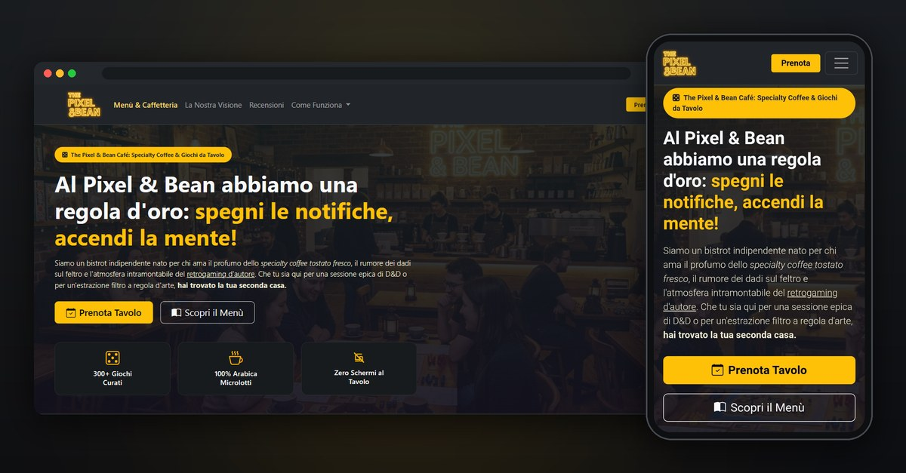

# The Pixel & Bean Café

Il sito di un bistrot immaginario dove si beve specialty coffee e si gioca ai giochi da tavolo, con una sola regola: *spegni le notifiche, accendi la mente*.

È un progetto front-end costruito con **HTML, CSS, Bootstrap 5.3 e JavaScript**, senza framework né backend.

**[Apri il sito](https://albfer94.github.io/web-da-zero/)**



---

## Da dove nasce

Tutto è partito da uno dei primi esercizi del corso Boolean: creare una pagina `index.html` per prendere confidenza con i tag HTML, ma con un contenuto che avesse senso. Avevo già un po' di familiarità con HTML, CSS e JavaScript, così invece di una pagina di prova ho inventato un locale: un bistrot dove si gioca ai giochi da tavolo.

Settimana dopo settimana, ogni argomento delle lezioni è finito nel progetto. Bootstrap per il layout e i componenti, poi cicli, funzioni, array di oggetti e localStorage per la logica. L'obiettivo non era aggiungere funzioni, ma verificare su un progetto concreto se avevo capito davvero quello che stavo studiando.

## Cosa si può fare sul sito

- **Sfogliare il menù**, diviso in due schede (Caffetteria Lenta e Snack Salva-Carte) più una sezione con le opzioni vegane.
- **Scoprire come funziona la serata** e i giochi più amati, in un carosello.
- **Leggere le recensioni e lasciarne una nuova**, che resta salvata anche dopo aver ricaricato la pagina.
- **Iscriversi alla newsletter**: un indirizzo già iscritto viene riconosciuto, anche se scritto con maiuscole diverse.
- **Prenotare un tavolo** con un form completo (ospiti, data e ora, gioco da preparare, richieste speciali e regolamento del tavolo). Le date passate non sono selezionabili e una prenotazione doppia viene rifiutata.

## Cosa ho messo in pratica

### Bootstrap 5.3

L'obiettivo iniziale del progetto era imparare Bootstrap usandolo davvero:

- **Layout a griglia** responsive, dal telefono al desktop
- **Navbar** con menu a scomparsa su mobile e menu a tendina
- **Tab** per le due sezioni del menù
- **Carousel** per i giochi più amati
- **Collapse** per le opzioni vegane, le recensioni aggiuntive e il regolamento del tavolo
- **Modal** con form per recensioni e prenotazioni
- **Utility** per spaziature, colori e tipografia, insieme a un foglio di stile con variabili CSS proprie (palette, raggi, ombre)

### JavaScript

| Concetto | Dove si vede nel progetto |
|---|---|
| Array di oggetti come fonte dei dati | menù, giochi, passi della serata e recensioni stanno in `data.js`, separati dalla logica |
| Moduli ES (`import` / `export`) | `cards.js` importa i dati da `data.js` |
| Cicli e funzioni | ogni sezione ha una funzione che genera una card e una che le scorre tutte e le inserisce nella pagina |
| Metodi degli array | `filter` divide il menù per categoria, `some` controlla le prenotazioni doppie, `includes` gli iscritti alla newsletter |
| Gestione degli eventi e dei form | invio di recensioni, newsletter e prenotazioni, con lettura e controllo dei campi |
| Rendering condizionale | i dialog di conferma mostrano un contenuto diverso se l'operazione riesce o viene rifiutata |
| localStorage | recensioni, iscritti e prenotazioni restano salvati nel browser; lettura protetta con `try/catch` e dati predefiniti come ripiego |
| Date | conversione del valore di `datetime-local` in `Date`, formattazione in italiano con `toLocaleString` e blocco delle date passate |

I dati scritti dall'utente vengono inseriti nei dialog con `textContent` e non come HTML, così un nome o un messaggio non possono alterare la pagina.

## Struttura

```
web-da-zero/
├── index.html              # reindirizza alla pagina del sito
└── pixel-bean-cafe/
    ├── src/index.html      # la pagina
    ├── style/styles.css    # stile personalizzato e variabili CSS
    ├── js/data.js          # i dati del sito (array di oggetti)
    ├── js/cards.js         # rendering, form, localStorage
    └── assets/             # immagini WebP, logo e favicon
```

## Provarlo in locale

1. Clona la repo:
   ```bash
   git clone https://github.com/AlbFer94/web-da-zero.git
   ```
2. Apri la cartella in VS Code e avvia `pixel-bean-cafe/src/index.html` con l'estensione **Live Server**.

Aprire il file con un doppio clic non basta: il JavaScript è organizzato in moduli ES, e i browser li caricano solo da un server, non da un file locale.

## Limiti e prossimi passi

- **È solo front-end.** Recensioni, iscrizioni e prenotazioni vengono salvate nel localStorage del browser di chi visita il sito: non arrivano a nessun server e ognuno vede solo le proprie.
- **Il form non conosce ancora gli orari del locale**, per esempio il lunedì di chiusura.
- **Prossimo passo:** ho appena iniziato a studiare React. L'idea è riprendere Pixel & Bean in un branch dedicato e riscriverlo a componenti.

---

Il locale, i prezzi e i contatti sono inventati: è un progetto dimostrativo.

Realizzato da **Alberto Ferullo** · [GitHub](https://github.com/AlbFer94)
